# TP2 PDI, Problema 1: detección y clasificación de monedas y dados

Procesamiento de Imágenes I (IA 4.4) · TUIA, FCEIA, UNR · 2026, 2° semestre

El código está en `problema1.py`. Se corre así:

```bash
python problema1.py
```

Lee `monedas.jpg`, imprime los resultados de cada etapa y guarda las figuras en `capturas/problema1/`.

## Qué pide el problema

La imagen `monedas.jpg` tiene monedas y dados sobre un fondo de intensidad no uniforme. El enunciado (`TUIA_PDI_TP2_2026_C2.pdf`, Problema 1) pide tres cosas:

| Punto | Consigna |
|---|---|
| A | Segmentar las monedas y los dados de manera automática |
| B | Clasificar los distintos tipos de monedas y contarlas |
| C | Determinar el valor de la cara superior de cada dado y contarlos |

Además el script tiene que informar y mostrar los resultados de cada etapa.

La imagen mide 3871x2681 píxeles. A simple vista hay 17 monedas (9 de 10 centavos, 5 de 1 peso y 3 de 50 centavos) y 2 dados, con un 5 y un 3 en la cara de arriba. Usamos ese conteo manual para verificar el resultado del script.

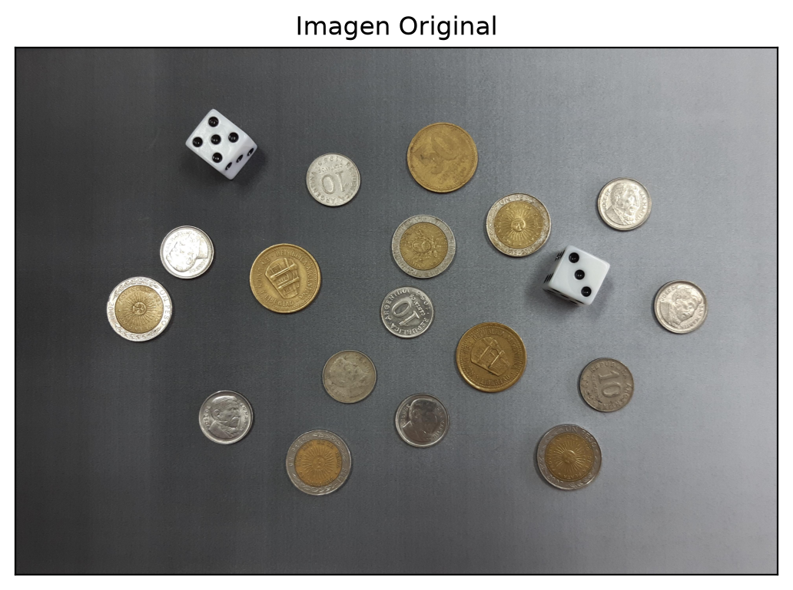

## Cómo lo resolvimos

### 1. Escala de grises y filtro pasabajos

Pasamos la imagen a grises y le aplicamos un filtro Gaussiano de 15x15 (`cv2.GaussianBlur`).

- De dónde sale: `U3/Codigo/PDI_U3_Segmentacion.py`, sección "CANNY", que suaviza con `cv2.GaussianBlur` antes de detectar bordes.
- Por qué hace falta: el fondo es una tela con textura. Sin suavizar, Canny marca esa textura como borde en toda la imagen.

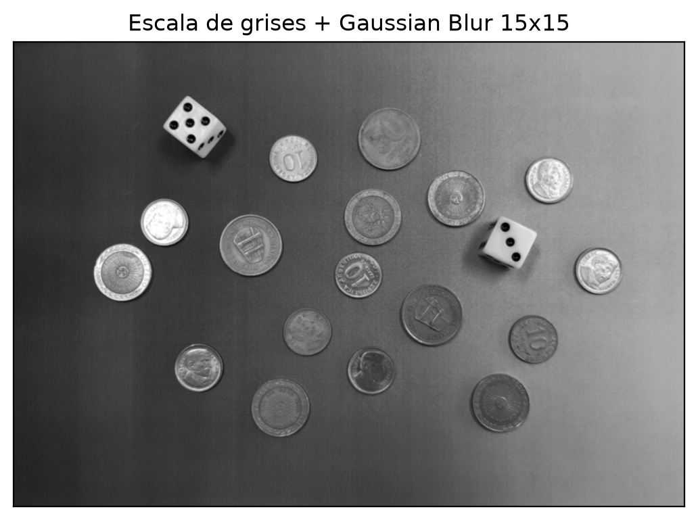

### 2. Bordes con Canny

Aplicamos `cv2.Canny` con umbrales 15 y 45. La salida tiene 135953 píxeles de borde repartidos en 3716 trozos sueltos.

- De dónde sale: la misma sección "CANNY" de U3 (detección de bordes por gradiente con histéresis).
- Por qué bordes y no un umbral: el fondo va de un gris oscuro a la izquierda (media 53) a uno claro a la derecha (media 170). Un umbral global no separa los objetos de ese fondo, porque hay monedas más oscuras que el fondo claro y más claras que el fondo oscuro. Los bordes dependen del cambio local de intensidad, que se mantiene aunque el nivel del fondo cambie.

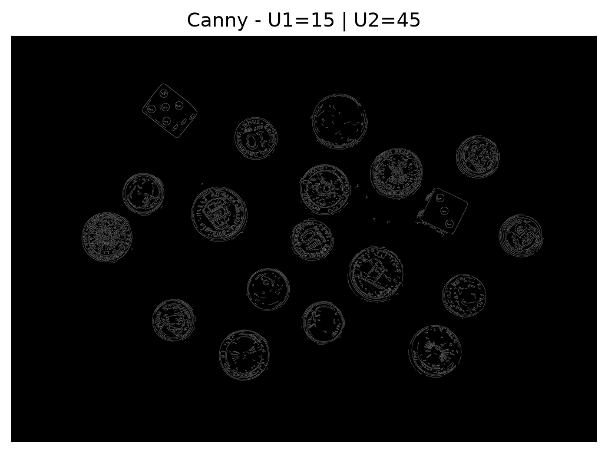

### 3. Dilatación para cerrar los bordes

Los contornos que entrega Canny tienen cortes. Los dilatamos con un elemento estructural elíptico de 35x35 (`cv2.dilate`) para que cada objeto quede encerrado por una curva continua.

- De dónde sale: `U6/Codigo/PI_U6_Morfologia_p1_Fundamentos.py`, sección "Dilatacion", y el comentario de `PI_U6_Morfologico_p2_Reconstruccion.py` que dilata la imagen antes de rellenar huecos para cerrar los detalles que lo impiden.

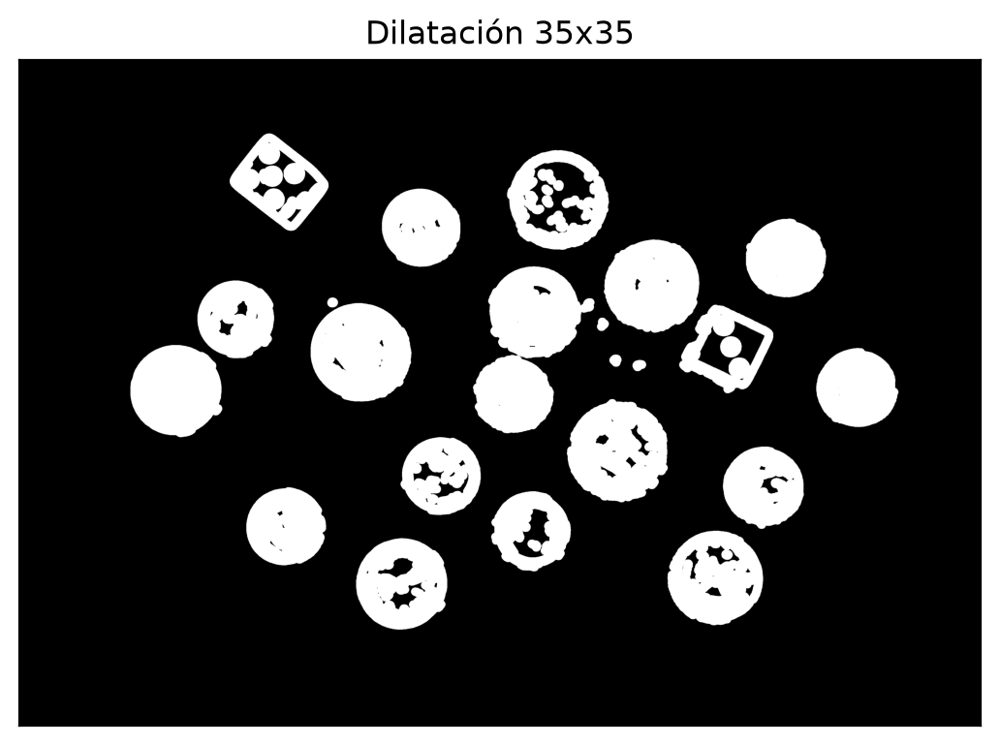

### 4. Rellenado de huecos

Con los contornos cerrados usamos `imfillhole_v2`, la versión con `cv2.floodFill` de la cátedra. Inunda el fondo desde la esquina (0, 0) y lo que no se inunda es interior de un objeto.

- De dónde sale: `U6/Codigo/PI_U6_Morfologico_p2_Reconstruccion.py`, sección "Rellenado de huecos", versión 2. La copiamos tal cual.
- Por qué la versión 2: la versión 1 usa reconstrucción morfológica, que itera dilataciones de 3x3 hasta converger. En una imagen de 3871x2681 eso tarda mucho más que una sola inundación.
- El orden importa. Si se rellena antes de cerrar los bordes, el fondo entra por los cortes y el objeto no se rellena.

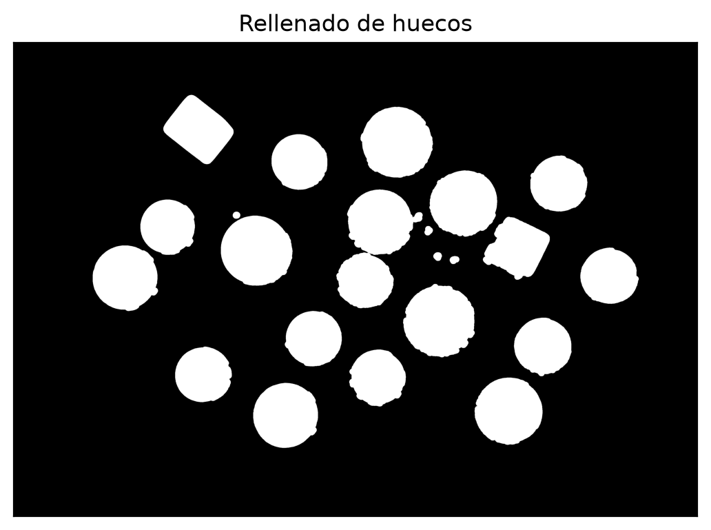

### 5. Erosión y apertura

La dilatación agranda cada objeto y puede unir objetos cercanos. Después del relleno contamos 18 objetos grandes en lugar de 19. Erosionamos con el mismo elemento de 35x35 (`cv2.erode`) y volvieron a ser 19, con su tamaño original.

Quedaban 5 restos chicos, de 231 píxeles como máximo, que vienen de bordes sueltos del fondo. Los eliminamos con una apertura elíptica de 41x41 (`cv2.morphologyEx` con `cv2.MORPH_OPEN`), que también suaviza el contorno de los objetos.

- De dónde sale: secciones "Erosion" y "Apertura" de `PI_U6_Morfologia_p1_Fundamentos.py`, y el "Ejemplo de aplicacion" de `PI_U6_Morfologico_p2_Reconstruccion.py`, que termina con una apertura para suavizar bordes.

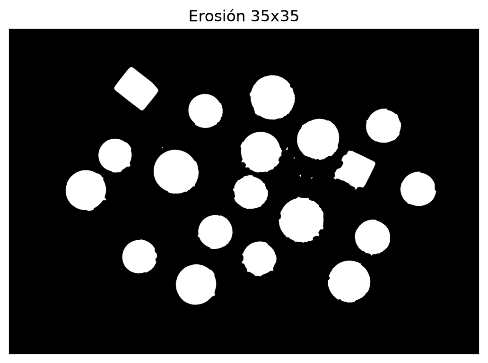


### 6. Componentes conectadas

`cv2.connectedComponentsWithStats` etiqueta los objetos y devuelve el área y el bounding box de cada uno. Quedan 19 objetos: los 17 de las monedas y los 2 de los dados. Para la figura coloreamos las etiquetas con `cv2.applyColorMap`.

- De dónde sale: `PDI_U3_Segmentacion.py`, sección "Componentes conectadas", y `U6/Extras/clasifico_celulas.py`.

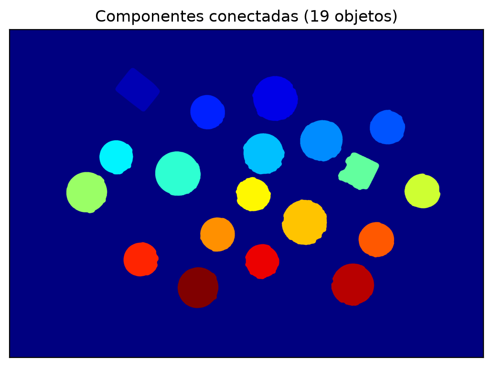

### 7. Factor de forma: monedas o dados

Para cada objeto calculamos el contorno externo con `cv2.findContours` y después 1/Fp = Perímetro² / Área, con `cv2.arcLength` y `cv2.contourArea`. Un círculo ideal da 12.57 y un cuadrado ideal da 16.

- De dónde sale: `Factor de Forma.txt` (fórmula y funciones) y `U6/Extras/clasifico_celulas.py`, que clasifica células en circulares o no con el mismo descriptor.
- Qué medimos: las 17 monedas dan entre 14.16 y 14.83. Los dados dan 16.13 y 17.71.
- Por qué las monedas no dan 12.57: el perímetro se mide sobre píxeles, con escalones, y el borde segmentado no es perfectamente liso. Los dos efectos suman perímetro.
- Umbral: 15.5, a mitad de camino entre la moneda menos circular (14.83) y el dado más circular (16.13). Menos de 15.5 es moneda.

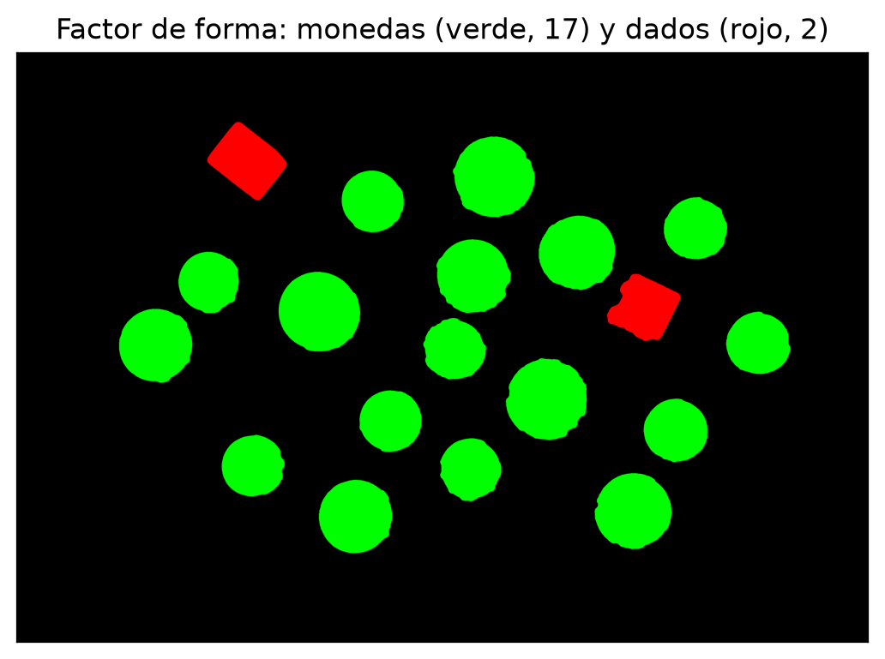

### 8. Clasificación de monedas con K-means sobre el área

Las monedas de 10 centavos, 1 peso y 50 centavos tienen diámetros distintos, así que el área las separa. Aplicamos `cv2.kmeans` con K = 3 sobre el área de las 17 monedas y ordenamos los tres centros de menor a mayor: el más chico es 10 centavos, el del medio 1 peso y el más grande 50 centavos.

- De dónde sale: `U5/Codigo/PDI_U5_ejemplo_kmeans.py` (misma llamada y mismo criterio de corte).
- Por qué K-means y no rangos escritos a mano: encuentra solo los saltos de área. Si la foto se toma a otra distancia las áreas cambian pero los tres grupos siguen estando.
- Fijamos la semilla con `cv2.setRNGSeed(0)` para que la corrida sea repetible.

| Tipo | Cantidad | Área mínima (px) | Área máxima (px) | Centro (px) |
|---|---|---|---|---|
| 10 centavos | 9 | 59829 | 64660 | 62053 |
| 1 peso | 5 | 87279 | 93021 | 89547 |
| 50 centavos | 3 | 104861 | 105438 | 105214 |

Entre la moneda más grande de un grupo y la más chica del siguiente hay más de 11000 píxeles de diferencia.

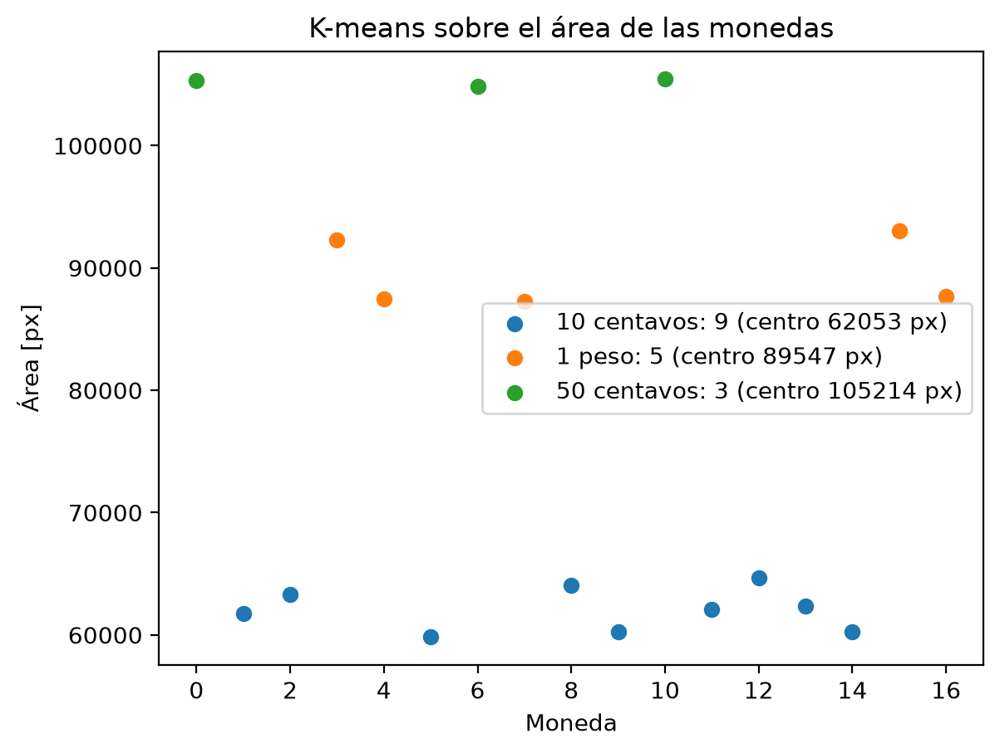

### 9. Valor de cada dado

Recortamos cada dado con su bounding box y calculamos el umbral de Otsu usando solo los píxeles del dado (`cv2.threshold` con `cv2.THRESH_OTSU`). El dado es blanco y los puntos son negros, así que el histograma tiene dos grupos bien separados. Otsu dio 116 para el dado 1 y 121 para el dado 2.

Lo que queda por debajo del umbral son manchas oscuras. Las etiquetamos con `cv2.connectedComponentsWithStats`, descartamos las de menos de 500 píxeles y a las demás les calculamos el mismo factor de forma del paso 7. Contamos como puntos las que dan menos de 15.5.

- De dónde sale: `PDI_U3_Segmentacion.py`, sección "Umbralado" (Otsu), más el factor de forma ya usado.
- Por qué el factor de forma: en la foto también se ven puntos de las caras laterales y sombras. Los puntos de la cara de arriba se ven redondos y dan entre 13.90 y 14.74. Los laterales se ven como elipses pegadas al borde. Esas manchas y las sombras dan más de 32.

| Dado | Manchas de más de 500 px | Circulares | Valor |
|---|---|---|---|
| 1 | 8 | 5 | 5 |
| 2 | 5 | 3 | 3 |

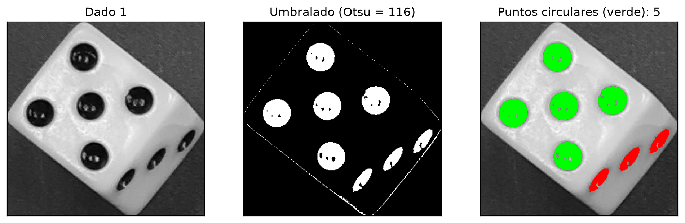

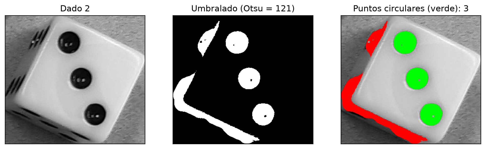

### 10. Imagen resultado

Dibujamos el contorno de cada objeto con un color por clase (`cv2.drawContours`) y escribimos el tipo de moneda o el valor del dado con `cv2.putText`. El script guarda la figura y también la imagen en tamaño completo (`12_resultado_completa.jpg`).

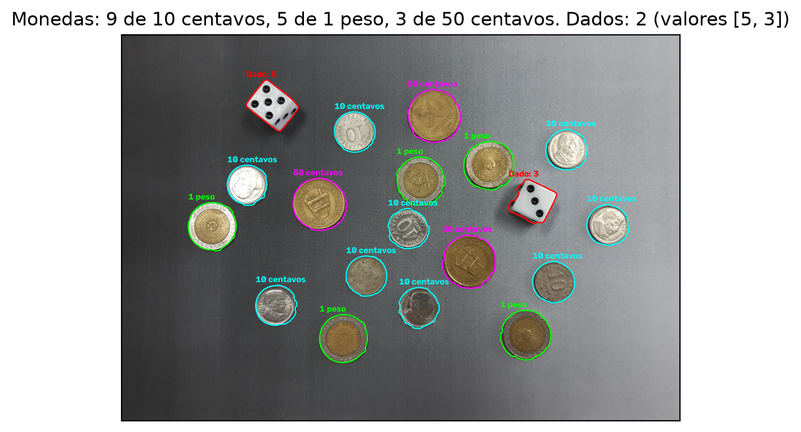

## Problemas que aparecieron

**Canny es sensible al suavizado y a los umbrales.** Probamos kernels de 5 a 21, umbrales bajos de 8 a 50 y dilataciones de 9 a 45. Con blur de 5x5 y Canny 15-45 la textura del fondo genera tantos bordes que el relleno toma la imagen completa como un solo objeto. Con blur de 15x15 y Canny 30-90 pasa lo contrario: varios contornos no cierran y solo quedan 14 objetos grandes. Elegimos blur 15x15 con Canny 15-45 porque da 19 objetos con tres tamaños de dilatación distintos (27, 35 y 45), y en los tres casos las monedas dan 1/Fp de 14.8 como máximo y los dados 16.1 y 17.6 o más. Con dilataciones de 15 y 21 quedan 18 objetos grandes. Nos quedamos con 35, el valor del medio.

**Contornos que no cerraban.** En la primera prueba (blur 9x9, Canny 30-90, dilatación 15x15) el dado de la derecha y una moneda de 50 centavos quedaron abiertos y no se rellenaron. El borde derecho de ese dado tiene poco contraste porque es blanco sobre la parte clara del fondo. Lo resolvimos con umbrales de Canny más bajos y una dilatación más grande.

**Objetos que se unen al dilatar.** Con la dilatación de 35x35 dos objetos cercanos quedan pegados (18 objetos grandes después del relleno). La erosión con el mismo elemento los separa. En la segmentación final, las dos monedas más cercanas de la izquierda quedan a 66 píxeles una de otra.

**El factor de forma medido no coincide con el teórico.** Lo explicamos en el paso 7. Por eso fijamos el umbral con los valores medidos sobre los 19 objetos.

**El color solo no alcanza.** Medimos la saturación media de cada moneda en HSV y el script la imprime. Las de 50 centavos (doradas) dan entre 123.9 y 141.6 y se distinguen bien. Pero una moneda de 10 centavos gastada da 62.9 y una de 1 peso da 65.0. Con una diferencia tan chica no se puede poner un umbral confiable, así que clasificamos por área.

**Puntos de las caras laterales.** Resuelto con el factor de forma en el paso 9.

## Parámetros finales

| Parámetro | Valor | Cómo lo elegimos |
|---|---|---|
| Filtro Gaussiano | 15x15 | Barrido de 5 a 21. Es el que da 19 objetos con más tamaños de dilatación |
| Umbrales de Canny | 15 y 45 | Barrido del umbral bajo de 8 a 50, con el alto igual al triple |
| Dilatación y erosión | elipse de 35x35 | Valor del medio de los tres que funcionan (27, 35 y 45) |
| Apertura | elipse de 41x41 | Elimina los 5 restos, que miden 231 px como máximo |
| Umbral de 1/Fp | 15.5 | Punto medio entre 14.83 (moneda) y 16.13 (dado) |
| K de K-means | 3 | Hay tres tipos de moneda |
| Umbral de los puntos | Otsu por dado | Automático. Dio 116 y 121 |
| Área mínima de un punto | 500 px | Los puntos miden cerca de 2000 px y el ruido mucho menos |

## Resultado

Salida del script en nuestra ejecución:

```
Monedas: 9 de 10 centavos, 5 de 1 peso, 3 de 50 centavos  (total 17)
Dados: 2  /  Valores de la cara superior: [5, 3]
```

Coincide con el conteo manual de la imagen.

## Cosas que decidimos nosotros

- El nombre de cada grupo de K-means sale del orden de tamaño (10 centavos, 1 peso, 50 centavos). Ese orden lo sabemos por las monedas reales y está escrito en la lista `TIPOS` del script.
- Los parámetros están ajustados para esta imagen. Con otra foto, otra iluminación u otra distancia habría que revisarlos, sobre todo el suavizado y los umbrales de Canny.
- El enunciado no pide el monto total, así que no lo calculamos.

## Fuentes usadas

| Archivo | Qué se tomó |
|---|---|
| `TUIA_PDI_TP2_2026_C2.pdf` | Consigna de los puntos A, B y C |
| `Factor de Forma.txt` | Fórmula Fp = Área / Perímetro², valor del círculo y funciones `findContours`, `contourArea`, `arcLength` |
| `U3/Codigo/PDI_U3_Segmentacion.py` | Función `imshow`, `GaussianBlur` + `Canny`, componentes conectadas, contornos, umbral de Otsu |
| `U6/Codigo/PI_U6_Morfologia_p1_Fundamentos.py` | Dilatación, erosión y apertura con `getStructuringElement` |
| `U6/Codigo/PI_U6_Morfologico_p2_Reconstruccion.py` | `imfillhole_v2` y la idea de cerrar antes de rellenar |
| `U6/Extras/clasifico_celulas.py` | Clasificación por factor de forma objeto por objeto y coloreado de etiquetas |
| `U5/Codigo/PDI_U5_ejemplo_kmeans.py` | Llamada a `cv2.kmeans` |
