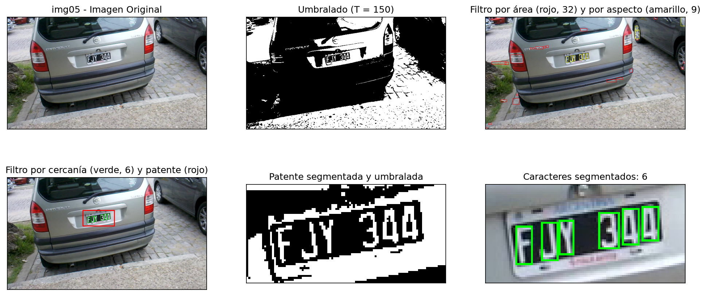
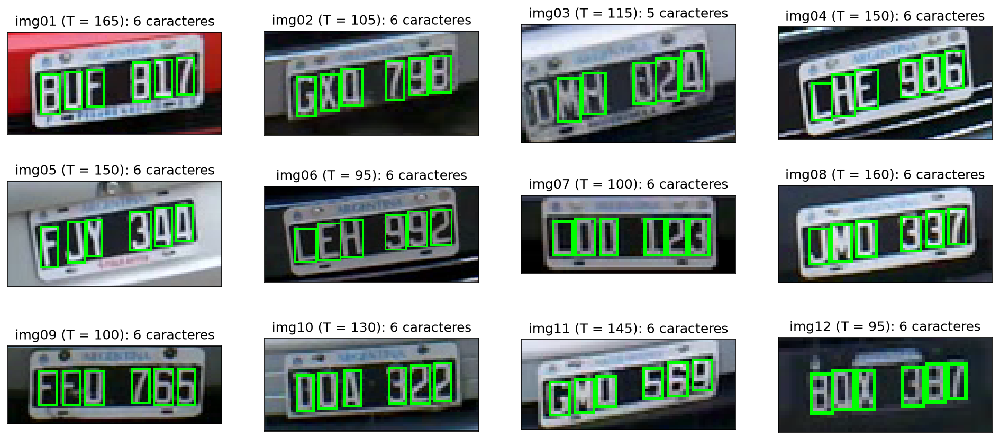
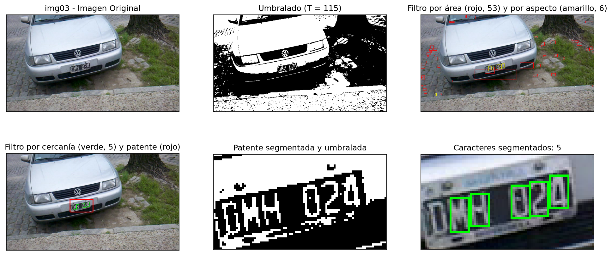

# TP2 PDI, Problema 2: detección de patentes

Procesamiento de Imágenes I (IA 4.4) · TUIA, FCEIA, UNR · 2026, 2° semestre

El código está en `problema2.py`. Se corre así:

```bash
python problema2.py
```

Procesa en ciclo las doce imágenes `img01.png` a `img12.png`, imprime los resultados de cada etapa y guarda las figuras en `capturas/problema2/`.

## Qué pide el problema

Cada imagen muestra el frente o la parte trasera de un auto con su patente. El enunciado (`TUIA_PDI_TP2_2026_C2.pdf`, Problema 2) pide, para cada una:

| Punto | Consigna |
|---|---|
| A | Detectar automáticamente la placa patente y segmentarla |
| B | Segmentar los caracteres de la patente detectada en el punto A |

El script tiene que informar y mostrar los resultados de cada etapa.

Las doce imágenes miden 640x360 píxeles. Las patentes son del formato argentino de tres letras y tres números, con caracteres blancos sobre fondo negro. En la imagen ocupan poco: los caracteres miden entre 10 y 21 píxeles de alto y entre 5 y 13 de ancho.

El archivo `info_patentes.txt` da tres datos que usamos: la relación alto/ancho de un caracter está entre 1.5 y 3.0, los caracteres forman grupos de a 3 y la patente tiene dos de esos grupos.

## Cómo lo resolvimos

El orden es el que sugirió la cátedra: primero encontramos los caracteres y con ellos ubicamos la patente. Las figuras de esta sección son de `img05.png`, la imagen del enunciado.



### 1. Escala de grises y umbralado

Pasamos la imagen a grises y la umbralamos con `cv2.threshold` y `cv2.THRESH_BINARY`. Los caracteres son blancos, así que quedan en 255.

- De dónde sale: `U3/Codigo/PDI_U3_Segmentacion.py`, sección "Umbralado".
- El valor del umbral cambia en cada imagen. Lo explicamos en el paso 5.

### 2. Componentes conectadas

`cv2.connectedComponentsWithStats` con conectividad 8 etiqueta cada objeto blanco y devuelve su bounding box y su área. Descartamos la etiqueta 0, que es el fondo. En `img05` con T = 150 salen 188 componentes.

- De dónde sale: `PDI_U3_Segmentacion.py`, sección "Componentes conectadas", y la validación de planillas del TP1.

### 3. Filtrado por área

Nos quedamos con las componentes de entre 15 y 300 píxeles de área. En `img05` pasan 32 de 188.

- De dónde sale: `U6/Extras/clasifico_celulas.py`, que descarta objetos por área con `stats`.
- Por qué esos valores: los caracteres reales midieron entre 18 y 161 píxeles de área según la imagen y el umbral. Dejamos margen de los dos lados.
- La cátedra sugirió descartar lo que supere el 10 % del área de la imagen (23040 píxeles acá). Lo probamos y da el mismo resultado en las doce imágenes, porque los objetos grandes que pasan ese filtro los eliminan los dos filtros siguientes. Usamos 300 porque está más cerca del tamaño real de un caracter.

### 4. Filtrado por relación de aspecto

De las que quedan, conservamos las que tienen alto/ancho entre 1.5 y 3.0. En `img05` pasan 9 de 32.

- De dónde sale: `info_patentes.txt`. El alto y el ancho son las columnas 3 y 2 de `stats`.

### 5. Filtrado por cercanía

Todavía hay falsos candidatos: reflejos, adoquines, partes de la parrilla. Los seis caracteres de una patente tienen tres cosas en común y las usamos como criterio de cercanía. Dos candidatos son vecinos si su alto difiere en menos del 25 %, si la posición vertical de su borde superior difiere en menos de medio alto y si su distancia horizontal es menor a 6 altos. Para cada candidato armamos el grupo de sus vecinos y nos quedamos con el grupo más numeroso. En `img05` quedan exactamente los 6 caracteres.

- De dónde sale: los datos de `info_patentes.txt` (grupos de 3 y dos grupos por patente) y la sugerencia de la cátedra de filtrar por cercanía hasta quedarse con los 3 + 3. La regla concreta la armamos nosotros.
- Los tres valores (25 %, medio alto y 6 altos) están expresados en altos de caracter para que no dependan del tamaño de la patente en la foto. Las patentes inclinadas entran igual: en `img03` el borde superior cambia 11 píxeles entre el primer caracter detectado y el último, con caracteres de 16 píxeles de alto.

### 6. Elección del umbral

No hay un umbral único que sirva para las doce imágenes. Probamos todos los valores de 20 a 240 de a 5 y anotamos con cuáles el filtro por cercanía deja 6 caracteres. Por ejemplo, `img01` necesita entre 145 y 180 e `img12` entre 80 y 110. Esos dos rangos no se tocan.

Por eso el script repite los pasos 1 a 5 con cada umbral de 20 a 240, busca el grupo más grande que no pase de 6 caracteres y elige el umbral del medio entre todos los que lo consiguen. El umbral del medio es el más alejado de los dos extremos donde la segmentación empieza a fallar.

- De dónde sale: la idea de recorrer umbrales y quedarnos con el del medio ya estaba en un intento anterior nuestro (`TP2_Problema2.py`). La reescribimos para este script.
- También probamos Otsu sobre la imagen completa. Da entre 92 y 134 según la imagen, y en varias queda fuera del rango que funciona (en `img01` da 114 y hace falta 145 o más).

### 7. Punto A: ubicar y recortar la patente

La patente es el rectángulo que encierra a los caracteres del grupo, más un margen de 0.8 altos de caracter a cada lado y 0.6 arriba y abajo. Recortamos esa región de la imagen original.

- El margen lo ajustamos mirando las doce imágenes hasta que el recorte incluyera el marco de la patente.
- La relación ancho/alto del recorte queda entre 1.81 y 2.75. La cátedra indicó 3/1.5 = 2 como referencia para la patente.

### 8. Punto B: segmentar los caracteres de la patente

Sobre el recorte del punto A repetimos el mismo procesamiento con el umbral elegido: umbralado, componentes conectadas, filtros de área y de aspecto y filtro por cercanía. El script imprime la posición, el tamaño y el área de cada caracter y los marca con un rectángulo sobre la patente.

## Resultados

Salida del script en nuestra ejecución:

| Imagen | Umbrales que funcionan | T usado | Componentes | Tras área | Tras aspecto | Tras cercanía | Caracteres |
|---|---|---|---|---|---|---|---|
| img01 | 145 a 180 | 165 | 648 | 104 | 12 | 6 | 6 |
| img02 | 90 a 120 | 105 | 159 | 38 | 9 | 6 | 6 |
| img03 | 105 a 125 (con 5) | 115 | 363 | 53 | 6 | 5 | 5 |
| img04 | 125 a 175 | 150 | 337 | 50 | 7 | 6 | 6 |
| img05 | 110 a 190 | 150 | 188 | 32 | 9 | 6 | 6 |
| img06 | 55 a 120 | 95 | 67 | 18 | 7 | 6 | 6 |
| img07 | 75 a 120 | 100 | 68 | 19 | 6 | 6 | 6 |
| img08 | 130 a 190 | 160 | 414 | 91 | 14 | 6 | 6 |
| img09 | 80 a 120 | 100 | 294 | 39 | 9 | 6 | 6 |
| img10 | 115 a 140 | 130 | 488 | 101 | 9 | 6 | 6 |
| img11 | 135 a 150 | 145 | 602 | 108 | 15 | 6 | 6 |
| img12 | 80 a 110 | 95 | 72 | 18 | 10 | 6 | 6 |

- Patente detectada: 12 de 12.
- Seis caracteres segmentados: 11 de 12.
- Falla `img03`, con 5 de 6.



## La imagen que falla: img03

La patente es DMH 024. El script encuentra M, H, 0, 2 y 4, y le falta la D.



La causa se ve en la imagen umbralada: la D está pegada al marco blanco de la patente. A esta resolución, entre el trazo izquierdo de la D y el marco hay una o dos columnas de píxeles de un gris intermedio. Con T = 120, por ejemplo, la D y un pedazo del marco forman una sola componente de 16x24 píxeles. Es más alta que los otros caracteres, que miden 16 o 17, y el filtro por cercanía la deja afuera. Con 125 o más la D se parte en pedazos antes de despegarse.

Probamos varias cosas para separarla. Ninguna resolvió `img03` sin romper otras imágenes:

- Recorrer los umbrales de a 1 en lugar de a 5. Sigue sin haber un umbral con 6 caracteres.
- Conectividad 4 en lugar de 8. Mismo resultado.
- Erosionar la imagen binaria. Con un elemento de 2x1 y los filtros de área y aspecto un poco más flojos, `img03` llegó a 6 caracteres con uno solo de los 45 umbrales, pero `img01` e `img11` dejaron de dar 6 con todos. Los trazos miden 1 o 2 píxeles y la erosión los corta. Con elementos de 1x2 y 2x2 fue peor: 8 y 6 imágenes bien.
- Agrandar la imagen 2 y 3 veces antes de umbralar. `img03` sigue en 5.
- Top-hat en grises (`U6/Codigo/PI_U6_Morfologico_p4_Grises.py`) antes de umbralar. `img03` sigue en 5.
- Umbral adaptativo (`cv2.adaptiveThreshold`). En la mejor combinación que probamos segmentó bien 7 de las 12, y `img03` no estaba entre ellas.

El punto A sí funciona en `img03`. El margen horizontal alcanza para que el recorte incluya la D aunque no se haya detectado.

## Otros problemas que aparecieron

**Un solo umbral no sirve.** Resuelto con el recorrido de umbrales del paso 6.

**Muchos objetos con forma de caracter.** Después de los filtros de área y aspecto quedan hasta 15 candidatos (`img11`). El filtro por cercanía los baja a 6 en todas las imágenes menos `img03`.

**Patentes chicas.** En `img12` los caracteres miden 10 u 11 píxeles de alto y 5 o 6 de ancho, con áreas desde 19 píxeles. Por eso el área mínima es 15 y no usamos ninguna operación morfológica sobre la imagen binaria.

**Rango angosto en algunas imágenes.** En `img11` solo 4 de los 45 umbrales probados dan 6 caracteres (135 a 150). Con un paso más grande que 5 se podría saltear ese rango.

## Parámetros finales

| Parámetro | Valor | Cómo lo elegimos |
|---|---|---|
| Umbrales probados | 20 a 240, de a 5 | Cubre los rangos que funcionan en las doce imágenes (de 55 a 190) |
| Área de un caracter | 15 a 300 px | Los caracteres midieron entre 18 y 161 px |
| Relación alto/ancho | 1.5 a 3.0 | `info_patentes.txt` |
| Diferencia de alto entre vecinos | 25 % | Ajustado con las doce imágenes |
| Diferencia vertical entre vecinos | 0.5 altos | Ajustado. Permite patentes inclinadas |
| Distancia horizontal entre vecinos | 6 altos | Ajustado. Una patente mide menos de 6 altos de caracter de ancho |
| Margen de la patente | 0.8 altos en x, 0.6 en y | Ajustado mirando los recortes |

## Cosas que decidimos nosotros

- La regla de cercanía del paso 5 y la elección del umbral del medio no están en el material de la cátedra.
- La patente se ubica a partir de sus caracteres. El recorte es un rectángulo alineado con la imagen, así que en las patentes inclinadas incluye algo del paragolpes.
- Si ningún umbral da 6 caracteres, el script usa el grupo más grande que encuentre e informa FALLA. Así la patente se detecta igual.
- El script no lee los caracteres. El enunciado pide segmentarlos.

## Fuentes usadas

| Archivo | Qué se tomó |
|---|---|
| `TUIA_PDI_TP2_2026_C2.pdf` | Consigna de los puntos A y B |
| `info_patentes.txt` | Relación de aspecto de los caracteres y estructura de 3 + 3 |
| `U3/Codigo/PDI_U3_Segmentacion.py` | Función `imshow`, umbralado con `cv2.threshold`, Otsu, `cv2.connectedComponentsWithStats`, `cv2.rectangle` |
| `U6/Extras/clasifico_celulas.py` | Filtrado de objetos por área con `stats` |
| `U6/Codigo/PI_U6_Morfologico_p4_Grises.py` | Top-hat, solo en las pruebas para `img03` |
| `TPs/Procesamiento_Imagenes_Grupo8_TP2/TP2_Problema2.py` | Idea de recorrer umbrales y elegir el del medio |
